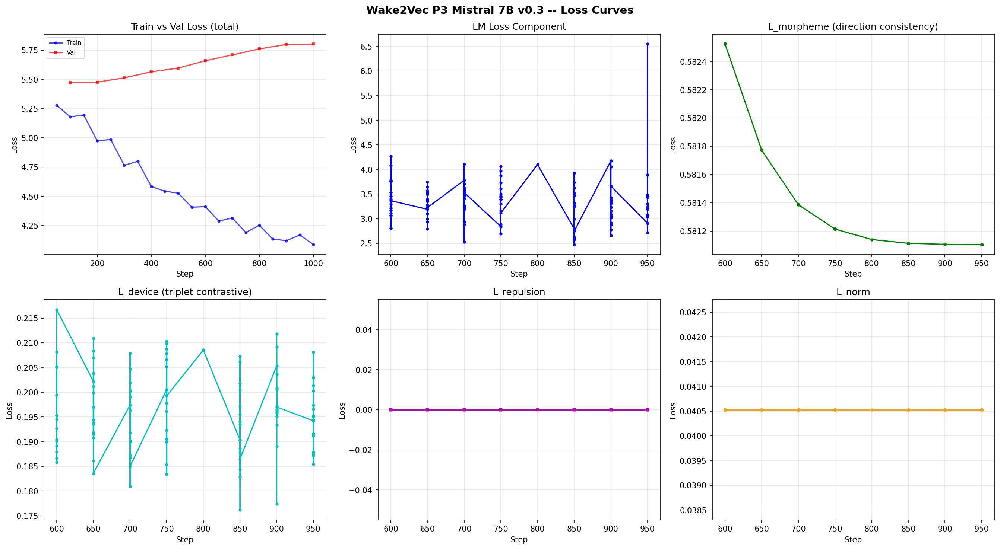

# wake2vec — Mistral 7B v0.3 P3 (strong) Results

> **Status: near complete.** Training, loss analysis, baseline and post-training permutation nulls, per-group movement, treated-versus-control, embedding analysis and device-group analysis are all done.

## Final Numbers

| Metric | Value |
|--------|-------|
| Model | mistralai/Mistral-7B-v0.3 (4-bit NF4, sliding-window attention) |
| Phase | P3 strong (morpheme-compositional alignment, corrected cosine loss) |
| P2 source | `full_checkpoints/step_0600` (P2 global minimum, val 4.705) |
| Steps | **1000 / 1000, completed** (688.2 min for the final 400, 103.1 s/step) |
| Best val (composite) | **5.4713 (step 100)** |
| Final val (composite) | 5.802403 |
| Final train (composite) | 4.086914 |
| Final train-val gap | 1.72 |
| **L_morpheme** | **0.6700 to 0.5811, converged** |
| **Excess over chance** | **+0.0458 to +0.1165** (each measured against its own matrix's null) |
| **Groups at z < −3** | **15 to 60** of 130 |
| L_device | 0.1960 run mean, flat, against a margin of 0.2000 |
| Morph loss mode | **`cosine`** (corrected; not the legacy squared-deviation) |
| λ_morph | **1.0** |
| λ_device | 2.0 |
| λ_repulsion | 0.05 |
| λ_norm | 0.01 |
| LoRA | r=8, α=16, dropout=0.1 |
| LoRA targets | q, k, v, gate_proj, up_proj, down_proj |
| LR | 2e-5 (halved from P2) |
| Batch | 1 × 16 grad-accum (effective 16) |
| SEQ_LEN | 256 (identical to P1 and P2) |
| Embeddings | **trainable** (Wake rows; base gradient-masked) |
| Base vocab | 32,768 declared (32,000 real, ~902 zero-norm rows) |
| Wake tokens | 44,553 (57.6% share) |
| Supervised morpheme pairs | 1,413 across 130 groups |
| **Rows receiving auxiliary gradients** | **2,261 of 44,553 (5.1%)** |




### Two configuration points that change how this run compares to the lineup

**1. λ_morph is 1.0, not 50.** `MORPH_LOSS_MODE = "cosine"`, and the script sets `LAMBDA_MORPH = 1.0 if MORPH_LOSS_MODE == "cosine" else 50.0`. The logged lines confirm it: `morph=0.5825(*1.0)`. The λ=50 figure belongs to the 
legacy squared-deviation loss, which was scale-dependent and is retracted (see `CORRECTIONS_0828.md`). **"Strong" in this run's name refers to λ_device = 2.0**, which is unchanged.

**2. This is the first P3 in the lineup to run the corrected loss.** TinyLlama P3, Llama 1B P3 and Llama 3B P3 all used the defective squared-Euclidean objective. Their morpheme nulls are arithmetic rather than evidential 
and **are not comparable to this run on the morpheme axis**. Their device results stand. Any cross-model morpheme table must be built from cosine-mode runs only.

---

## The arc

| Step | train (comp.) | val (comp.) | morph | consistency | val LM | vs P2 (4.705) | gap |
|------|------|------|------|------|------|------|------|
| 0 | 5.9227 | n/a | **0.6700** | 0.3300 | n/a | | |
| 100 | 5.1797 | **5.4713** | 0.6555 | 0.3445 | **4.4215** | 0.28 better | |
| 200 | 4.9743 | 5.4763 | 0.6218 | 0.3782 | | | |
| 300 | 4.7649 | 5.5133 | 0.6017 | 0.3983 | | | |
| 400 | 4.5838 | 5.5649 | 0.5908 | 0.4092 | | | |
| 500 | 4.5266 | 5.5972 | 0.5852 | 0.4148 | | | |
| 600 | 4.4110 | 5.6599 | 0.5825 | 0.4175 | 4.6843 | 0.02 better | |
| 700 | 4.3137 | 5.7098 | 0.5814 | 0.4186 | 4.7397 | 0.035 worse | 1.40 |
| 800 | 4.2518 | 5.7610 | 0.5811 | 0.4189 | 4.7875 | 0.083 worse | 1.51 |
| 900 | 4.1197 | 5.7992 | 0.5811 | 0.4189 | 4.8220 | 0.117 worse | 1.68 |
| 1000 | 4.0869 | 5.8024 | (not logged) | | 4.8289 | 0.124 worse | 1.72 |

**The consistency column is raw, not chance-corrected.** A permutation null exists only for step 0 and step 1000, because the null has to be recomputed on each matrix (see below), and intermediate matrices were not kept at that resolution. The chance-corrected endpoints are +0.0458 and +0.1165.

`val LM` subtracts the auxiliary offset from the composite, since no P3 script overrides `prediction_step` and `eval_loss` therefore contains the weighted auxiliaries. The offset uses each step's own device mean where sixteen micro-batches were logged and the run-wide mean (0.1960) at steps 800 and 1000. Device varies ±0.004 between intervals, propagating ±0.008 into `val LM`, an order of magnitude below every quantity compared here.

### The crossing point

Interpolating between steps 600 and 700, **P3 stops improving held-out language modelling at roughly step 637.** Before that the run is simultaneously improving LM fit and raising the morpheme effect. After it, the geometric movement is still being bought but no longer for free.

The cost past the crossing decelerates and settles: increments of 0.048, 0.034, 0.007 across the last three evaluations, converging at **0.124 nats above the P2 minimum**. P3 does not run away from P2.

### The cost is a generalisation gap, not a failure to fit

Train loss falls monotonically 4.3137 to 4.0869 while the gap widens monotonically 1.40 to 1.72, with `[WARN] Large train/eval gap` at every evaluation. The model fits training blocks better and better while validation refuses to follow. **This is the same signature recorded for the Llama 3B under the legacy loss**, which gives it two architectures and two loss formulations.

---

## Finding 1: the morpheme objective moves geometry, and the movement survives its own null

**L_morpheme descended 0.6700 to 0.5811 across the full budget, monotone at every one of nineteen intervals.** The last 350 steps are a geometric decay:

| interval | Δ morph | ratio |
|---|---|---|
| 600 to 650 | −0.000751 | |
| 650 to 700 | −0.000386 | 0.51 |
| 700 to 750 | −0.000172 | 0.45 |
| 750 to 800 | −0.0000743 | 0.43 |
| 800 to 850 | −0.0000267 | 0.36 |
| 850 to 900 | −0.0000072 | 0.27 |
| 900 to 950 | −0.0000013 | 0.18 |

Extrapolated asymptote **0.581105**, already reached to seven decimal places. This is a curve that stopped, not a curve that ran out of budget.

### The chance floor moved, and it had to be remeasured

| quantity | pre (step 0) | post (step 1000) | delta |
|---|---|---|---|
| observed L_morph | 0.669970 | 0.581105 | −0.088865 |
| observed consistency | 0.330030 | 0.418895 | +0.088865 |
| **null mean consistency** | **0.284269** | **0.302360** | **+0.018091** |
| **EXCESS OVER CHANCE** | **+0.045761** | **+0.116535** | **+0.070773** |
| null sd | 0.000928 | 0.000954 | |
| z | −49.33 | **−122.16** | |
| groups at z < −3 | 15 / 130 | **60 / 130** | +45 |
| pairs in those groups | 205 (14.5%) | **900 (63.7%)** | +695 |

**The excess is +0.1165, not the +0.1346 an earlier draft of this file quoted.** That earlier figure subtracted the step-0 null mean from the step-1000 observation, mixing two matrices. The permutation null is a function of the matrix it is computed over, and the Wake block drifted about 7% in norm, so the floor moved with it. The amount by which the mixed figure overstates is **exactly the amount the chance floor rose**: 0.018091. As a fraction, the mixed figure overstates the effect by 15.5%.

The corrected gain is **+155%**, not the +195% that followed from the mixed figure.

**This is itself a result worth reporting.** The null mean rising by +0.0181 means the morpheme loss made *all* direction vectors somewhat more mutually aligned, not only the within-group ones. Decomposing the raw +0.0889 consistency gain:

- **+0.0181 (20.4%) is non-specific**: a global alignment of the direction field that random regrouping reproduces.
- **+0.0708 (79.6%) is group-specific**: it survives the permutation and is what the objective was asking for.

Four fifths of the movement is real and one fifth is an artefact that only a matched null exposes. Running the null on the pre-training matrix alone would have reported all of it as signal.

---

## Finding 2: the loss did not amplify existing structure, it manufactured new structure

This is the sharpest result in the run and it **contradicts the hypothesis the analysis cell was written to test.** The cell prints:

> If the groups that gained are the ones that already had structure (the Latinate nominalisation cluster: -ion, -ation, -ition, -fication), the loss amplifies existing structure and cannot manufacture it.

The fifteen largest gainers:

| morpheme | n | z_pre | z_post | Δz | Δ excess |
|---|---|---|---|---|---|
| -x | 8 | −1.51 | −6.89 | −5.38 | +0.18403 |
| dif- | 4 | −1.14 | −4.71 | −3.57 | +0.17415 |
| super- | 3 | −1.45 | −4.57 | −3.12 | +0.17050 |
| -ory | 8 | −1.92 | −6.47 | −4.55 | +0.15967 |
| em- | 10 | −1.45 | −6.36 | −4.91 | +0.15004 |
| sup- | 5 | −1.97 | −5.20 | −3.23 | +0.14176 |
| sur- | 4 | **+0.55** | −2.49 | −3.04 | +0.13697 |
| -less | 5 | −1.87 | −4.97 | −3.10 | +0.13609 |
| mis- | 13 | −3.02 | −7.63 | −4.61 | +0.13099 |
| -ier | 8 | −1.81 | −5.26 | −3.46 | +0.12656 |
| -ery | 13 | −0.86 | −5.53 | −4.67 | +0.12495 |
| pur- | 6 | −1.55 | −4.68 | −3.13 | +0.12097 |
| under- | 5 | **+0.16** | −2.79 | −2.96 | +0.12071 |
| -ual | 3 | −0.70 | −2.96 | −2.26 | +0.11849 |
| -gon | 4 | −1.43 | −3.84 | −2.41 | +0.11650 |

**Fourteen of the fifteen were not significant before.** Only `mis-` (z_pre −3.02) was in the original fifteen, and it was last on that list. **Two of them, `sur-` (+0.55) and `under-` (+0.16), were worse than chance before P3 and are significant after it.**

Meanwhile the Latinate nominalising cluster, which carried essentially all the pre-training structure, is **absent from the movers list entirely**. Its z values barely change: `-ion` −18.93 to −19.7, `-ation` −16.91 to −16.2, `-fication` −9.41 to −8.1, `-ition` −8.78 to −8.5, `-ure` −8.36 to −8.1. `-ation` and `-fication` are marginally *weaker* after P3.

So the mechanistic conclusion the cell offered is the wrong way round:

> **The loss did not amplify what was already there. What was already there was at ceiling and did not move. The gain came from groups that had no structure at all.**

`-fication` entered P3 at consistency 0.983 and had nowhere to go. `-ery` entered at 0.297 and reached 0.439. The objective spent its capacity where there was headroom.

### The honest caveat: headroom and group size are confounded here

Every one of the fifteen movers is a small group (n = 3 to 13). The groups that did not move are the large ones. The post-training bottom ten by raw consistency is `-ous` (33), `be-` (39), `-le` (28), `de-` (33), `con-` (30), `re-` (50), `un-` (21), `-al` (29), `in-` (35), `-en` (27); every one has n ≥ 21. The top fifteen by raw consistency are all n = 3 to 5.

Two explanations are live and this data cannot separate them:

1. **Headroom.** Small groups start lower in chance-corrected terms and have more room to gain.
2. **Variance.** A group of three direction vectors can be pulled into alignment cheaply; a group of fifty cannot.

What would settle it is a regression of Δexcess on n and on pre-training excess, which is a few lines on the existing JSON and is the obvious next analysis. Until then the claim is stated at the level the evidence supports: **the gain concentrated in groups that lacked structure, and those groups are also small.**

### The raw consistency ranking is a group-size artefact and should not be quoted

The "top 15 most consistent morpheme directions" table ranks `-fication` (n=3, 0.9830), `-head` (n=3, 0.8292), `super-` (n=3, 0.7888) at the top. With three direction vectors, cosine to the mean is close to forced. The Llama 3B outputs file already flagged this; the permutation null is precisely the correction for it, which is why the z-ranking (`-ion` −19.7, `-ation` −16.2) and the raw ranking share almost no members. **Quote z or excess, never raw consistency.**

### Direction-consistency delta, as the cell computes it

| quantity | value |
|---|---|
| groups paired | 130 |
| mean direction consistency | 0.419111 to 0.499861 |
| mean delta | **+0.080750** |
| groups that improved | **130 / 130** |
| largest single-group move | +0.196871 (`-x`) |
| mean direction magnitude delta | +0.000815 |

The cell warns that movement "should concentrate in groups that already carried structure, not appear uniformly". **It appeared uniformly: 130 of 130 improved.** That is the cell's own stated signature of a non-specific effect, and it is consistent with the +0.0181 rise in the null mean. The resolution is that both things are true at once: there is a uniform component, the permutation null removes it, and a group-specific effect of +0.0708 remains underneath. The uniform appearance is not a reason to discount the result, but it is a reason never to quote the raw +0.0808 or +0.0889 as the effect size.

Note that the group-unweighted mean (0.4191) is far above the pair-weighted one (0.3300) for the same matrix, for the same small-group reason.

---

## Finding 3: the morpheme direction is consistent in coinages and inconsistent in established words

The pair-level view is where the mechanism is legible. For `re-` (n=50, consistency 0.3032):

| most aligned | cos | least aligned | cos |
|---|---|---|---|
| repunked → punked | 0.6562 | revise → vise | 0.0669 |
| recourses → courses | 0.6331 | repentance → pentance | 0.0568 |
| reformatory → formatory | 0.5582 | relief → lief | 0.0486 |

And `un-` (n=21, consistency 0.2921):

| most aligned | cos | least aligned | cos |
|---|---|---|---|
| underheerd → derheerd | 0.5294 | unbeaten → beaten | 0.1363 |
| unchanging → changing | 0.5051 | undisturbed → disturbed | 0.0969 |
| unnumerose → numerose | 0.4585 | unintentionally → intentionally | 0.0888 |

The split is not whether the prefix is semantically live. In `unbeaten → beaten` the `un-` is perfectly live and the cosine is 0.136. The split is **whether the word is a Wake coinage or an established English word**. `repunked`, `unnumerose`, `underheerd` are coinages; `revise`, `relief`, `unbeaten`, `undisturbed`, `unintentionally` are ordinary lexical items.

The reason follows from what this project does. **Injected Wake tokens have no usage history, so their embeddings have nothing to encode but their morphology. Established tokens have usage, and usage wins.** `relief` is not `re` plus `lief` to a language model, because `relief` has thousands of contexts of its own and `lief` has almost none.

This **sharpens the Llama 3B's diagnosis rather than repeating it.** The 3B concluded that "embeddings encode semantic usage, not morphological derivation", citing *evening ≠ even + ing*. The corrected measurement locates the boundary: embeddings encode derivation **wherever there is no usage to compete with it**, which is exactly the injected vocabulary, and refuse it wherever usage exists. That is also why the Latinate nominalising family carried structure before P3: those suffixes are productive on coinages.

### Two data-quality issues this view exposes

**Prefix groups are built by string matching and are not disjoint.** `underheerd → derheerd` is listed under `un-`, but the word is `under` + `heerd`. The same pattern explains the cross-group similarity table's single large value, `super-` to `sup-` at **0.8412**: every word beginning `super` also begins `sup`, so the two groups overlap by construction. `super-` has n=3 and `sup-` has n=5.

This does not invalidate the permutation null, which only requires that group labels be exchangeable. It does mean the per-group results for overlapping prefixes are not independent, and `sup-` and `super-` should not be counted as two findings. Worth auditing the group builder for `un-`/`under-`, `sup-`/`super-`, `com-`/`con-`, `in-`/`ition`.

**Every other cross-group pair is near-orthogonal**, 0.19 to 0.25 at the top and −0.07 to −0.27 at the bottom. There is no shared "derivation subspace"; each morpheme's direction is its own. Same conclusion as the 3B.

---

## Finding 4: treated versus control confirms the auxiliary losses bit

The controlled test. Every Wake row is unfrozen, so untouched rows still receive LM gradients and simply never receive auxiliary ones. Treated is LM plus auxiliary, control is LM only, and the difference isolates the auxiliary effect.

**Treated rows: 2,261 of 44,553 (5.1%).** Control is a size-matched random sample of the untouched rows.

| subset | n | iso_pre | iso_post | Δ iso | drift_cos | drift_L2 |
|---|---|---|---|---|---|---|
| treated (LM + aux) | 2,261 | 0.993277 | 0.993690 | +0.000414 | 0.984599 | **0.04567** |
| control (LM only) | 2,261 | 0.993950 | 0.994029 | +0.000078 | 0.997395 | **0.02601** |
| **difference in differences** | | | | **+0.000335** | **−0.012796** | **1.76×** |

**Treated rows moved 1.76 times further than control**, under identical LM pressure. This is the direct evidence that the morpheme and device objectives, and not the language-modelling objective, produced the geometric change. It is what the top-drifted token list gestured at and could not deliver.

The isotropy difference-in-differences is +0.000335: treated isotropy rose about five times more than control, but both numbers are tiny and sit against a base of 0.993. **The isotropy instrument confirms the direction and contributes nothing to the magnitude**, which is consistent with the aggregate null below.

Note that 5.1% supersedes the 2.5% an earlier draft of this file quoted. That figure counted only the 1,125 distinct Wake rows in morpheme pairs; the treated set also includes the device-group words.

---

## Finding 5: the device loss sits at its own margin, which is what "no information" looks like

The triplet loss is `clamp(margin + cos_neg − cos_pos, min=0).mean()` with `DEVICE_MARGIN = 0.2`.

If device labels carry no information, `cos_pos` and `cos_neg` are draws from the same distribution, their difference has mean zero, and **the loss evaluates to the margin itself, 0.2000.** The run mean is **0.1960**.

Backing out the implied separation: Wake-to-Wake pairwise cosine is 0.0556 ± 0.0389, so the difference has a spread of about 0.055 and the relu truncates a negligible 0.016% of the mass. Therefore

> same-device pairs exceed different-device pairs by about **0.0040** in cosine, against a within-Wake spread of 0.039.

**That is a far stronger statement of the device null than "flat in the 0.17 to 0.22 band".** The loss is not failing to converge; it is pinned at the value that means the categories are indistinguishable, with a residual separation of four thousandths.

### The mechanism, on both axes

**Intra-group coherence (is each category internally tight?)**

| device | words | intra-group mean cosine |
|---|---|---|
| nonce | 757 | 0.0405 |
| malapropism | 690 | 0.0374 |
| portmanteau | 465 | 0.0451 |
| foreign | 150 | 0.0320 |
| pun | 61 | 0.0373 |

All near the Wake-wide baseline of 0.0556. Words inside "portmanteau" are no more similar to each other than Wake tokens in general. **There is no pre-existing cluster for the triplet loss to tighten.**

**Inter-group separation (do the categories separate?)**

| | nonce | malaprop | portm | foreign | pun |
|---|---|---|---|---|---|
| nonce | 1.0000 | 0.9308 | 0.9240 | 0.7590 | 0.7248 |
| malapropism | 0.9308 | 1.0000 | 0.9236 | 0.7534 | 0.7168 |
| portmanteau | 0.9240 | 0.9236 | 1.0000 | 0.7175 | 0.7057 |
| foreign | 0.7590 | 0.7534 | 0.7175 | 1.0000 | 0.5754 |
| pun | 0.7248 | 0.7168 | 0.7057 | 0.5754 | 1.0000 |

The three largest categories sit at **0.92 to 0.93** to each other. They do not merely fail to separate; their centroids point in very nearly the same direction. For clustering to be learnable you would want low or negative inter-centroid cosine.

**Why Mistral's version is more extreme than the 3B's.** The 3B measured intra 0.008 to 0.030 and inter 0.41 to 0.73. Mistral is higher on both. The cause is visible in the pairwise table: Mistral's Wake-to-Wake mean cosine is **0.0556** against the 3B's **0.0003**. Mistral's Wake block has a real shared component, and averaging 757, 690 and 465 rows makes that common direction dominate each centroid while the individual differences cancel.

> **Mistral's higher Wake internal coherence is precisely what makes its device centroids collapse onto one another.** The property that made this model the lineup's best chance of moving the geometry is the same property that makes its device categories least separable.

Note that Mistral's device inventory has five categories; the 3B had six, including the `faust` group that was orthogonal to all the others.

---

## Embedding analysis (step 1000)

### Norms

| | Mean | Std | n |
|---|------|-----|---|
| Base | 0.1678 | 0.0329 | 32,768 |
| Wake | **0.3982** | 0.0415 | 44,553 |
| Welch t | t = −860.02, p = 0.00 | | |
| Mann-Whitney U | U = 189, p = 0.00 | | |
| Cohen's d | **−6.15** | | |

The Wake block sits at **2.37× base norm**. The d = −6.15 separation is the injection signature recorded across the lineup.

### Isotropy (Mu et al. 2018 partition function ratio)

| population | pre | post | delta |
|---|---|---|---|
| All | 0.891352 | 0.886769 | −0.004583 |
| Base | 0.960480 | 0.960480 | **+0.000000** |
| Wake | 0.993415 | 0.993450 | **+0.000035** |

**Base at delta exactly zero is the strongest confirmation in the project that gradient masking held.**

The analysis cell prints: *"Reads as NULL: strong lambdas did not move the Wake geometry, from the one configuration in the lineup that had structure to move."* **The null is real; the scope in that sentence is too wide and must not be inherited.**

Only **5.1%** of the Wake block receives auxiliary gradients. Isotropy here is a partition-function ratio over a 5,000-row sample, so roughly 255 treated rows enter the estimate, and the aggregate dilutes the effect about twentyfold. A loss that rotates difference vectors within 5% of the population, without changing the spread of the point cloud, is not something this instrument can resolve. The treated-versus-control result above measures the same rows directly and finds 1.76× the drift. The defensible statement:

> Strong lambdas did not move **global** Wake isotropy, measured on a sample in which treated rows are 5% of the draw. On those rows specifically they produced 1.76× the drift of an LM-only control and raised chance-corrected direction consistency by +0.0708. The two results concern different populations and do not conflict.

**Isotropy is the wrong instrument for this effect; the permutation excess and the treated-control contrast are the right ones.** What the isotropy null does establish cleanly is that P3 reshaped a subset of the Wake block without disturbing its overall geometry.

The **All** figure dropping −0.004583 while both components are flat means the *relation between* the base block and the Wake block changed more than either block internally. With base-to-new mean cosine at 0.0032 and the norm ratio at 2.37, the mixture statistic is sensitive to shifts neither sub-population registers.

### Drift (pre-P3 to post-P3)

| | Cosine | L2 |
|---|--------|-----|
| Base | 0.972473 ± 0.163613 | **0.000000 ± 0.000000** |
| Wake (all) | 0.996761 ± 0.010756 | 0.027040 ± 0.015408 |
| Wake (treated only) | 0.984599 | **0.045670** |
| Wake (control only) | 0.997395 | **0.026010** |

Top-drifted Wake tokens, with supervised morpheme group where applicable: `schott` (0.371), `punked` (0.401), `ond's`, `ceder`, `galory` (-ory), **`suspensive`** (-ive), `vux`, `hennery`, `monsie`, **`vaticination`** (-ation), `tous`, `rapax`, **`miserecordation`** (-ation), `priam`, `flappery`, `costellous`, `marrier` (-ier), `buccinate`, **`teasy`** (-sy), `tussle`.

With the treated-control result in hand this list no longer has to carry any inferential weight, and it should not: the LM gradient moves all 44,553 rows while 2,261 are treated, so the ranking is dominated by LM movement. Note that `punked` appears second here and `repunked → punked` is the single best-aligned `re-` pair in the run.

`suspensive` appearing sixth is a coincidence and gets exactly this sentence.

### Pairwise cosine

| | Mean | Std |
|---|------|-----|
| (base, base) | 0.0237 | 0.0232 |
| (new, new) | 0.0556 | 0.0389 |
| (base, new) | **0.0032** | 0.0173 |
| KS (bb vs nn) | D = 0.4704, p ≈ 0 | |

**The Wake block occupies its own near-orthogonal subspace and is internally more coherent than base vocabulary** (0.056 against 0.024). This inverts the Llama 3B's pattern, where base clustered at 0.1439 and Wake was near-orthogonal to itself at 0.0003. It is consistent with Mistral P1 being the only run in the lineup to leave the Wake region below the 0.998 isotropy attractor, it is why this model was the project's live shot at moving the geometry, and, as Finding 5 shows, it is also why its device categories are the least separable in the set.

### Top-1 principal component

| | Top-1 PC |
|---|---|
| Base | 0.0074 |
| Wake | **0.0251** |

The Wake block has one meaningfully dominant direction, 3.4× base, where the 3B's Wake top-1 PC (0.0006) was 20× flatter than its base. Same inversion, same explanation.

---

## Three reporting artefacts in the shared analysis cell

Cell bugs, not findings. The cell is shared, so these will fire identically on Qwen, Phi and the Llamas.

**1. `>> Significant base drift detected (unexpected if masked)` is a false alarm.** It is gated on mean cosine (0.972473) while L2 distance in the same block reads **mean 0.000000, std 0.000000**. The base rows did not move. The cosine deficit comes from zero-norm rows, where `cos(0, 0)` returns 0 rather than being excluded. The arithmetic confirms it exactly: for a Bernoulli in which a fraction p of rows read 0 and the rest 1, mean = 1 − p and sd = √(p(1−p)). Solving 1 − p = 0.972473 gives p = 0.027527, hence **902 zero rows of 32,768**, and predicts sd = √(0.027527 × 0.972473) = **0.163613**, matching the reported value to six decimals. Mistral declares 32,768 slots against a 32,000-token vocabulary. **Gate the warning on L2.**

**2. `90% variance in 101 PCs, 95% in 101 PCs` is the component cap, not a measurement.** Identical values for both thresholds and both populations is the signature of a `searchsorted` returning array length when the threshold is never crossed. The plot shows cumulative explained variance reaching only **0.14 (base) and 0.18 (new) at PC 101**. **Report the top-1 PC ratio instead.**

**3. The Wake-to-base nearest-neighbour table has no signal to read.** Maximum cosine in the printed list is **0.150** against a base-to-new mean of 0.0032. At that level the top-5 list is ranking noise in the tail of a zero-centred distribution, which is why the "neighbours" are code fragments and control characters. **The finding is the orthogonality; the identities are not interpretable.**

A fourth, in the cells added for this run: **the per-group movement commentary in Cell 14b states a conclusion the data contradicts.** It predicts gains will concentrate in groups that already had structure; they concentrated in groups that had none. See Finding 2. The printed text should be turned into a question rather than a conclusion.

---

## Cross-phase summary (Mistral 7B v0.3 full pipeline)

| Phase | Best val | Steps | Wake isotropy | Key finding |
|-------|----------|-------|---------------|-------------|
| P1 | 10.9181 (step 1200) | 1200 | **0.995** | largest Wake reorganisation in the lineup (drift cosine 0.485); the only region below the 0.998 attractor |
| P2 | **4.705 (step 600)** | 1200 | 0.995 (frozen) | cleanest overfit checkmark in the project, −6.21 from P1 |
| P3 strong | 5.4713 composite / 4.4215 LM (step 100) | **1000, complete** | 0.9935 | **chance-corrected excess +0.0458 to +0.1165**; 15 to 60 significant groups; treated rows drift 1.76× control; device loss pinned at its margin |

**The Mistral pipeline is complete: P1, P2, P3 at a full 1000-step budget.** It is the first complete pipeline to run the corrected cosine morpheme loss.

---

## The paper claim

*Under a corrected cosine morpheme objective at λ=1.0, auxiliary geometric pressure on Mistral 7B's injected Wake embedding raises chance-corrected morphological direction consistency from +0.0458 to +0.1165, each measured against a 500-permutation null computed on its own matrix, and takes the number of morpheme groups significant at z < −3 from 15 to 60 of 130, covering 14.5% to 63.7% of supervised pairs. Measuring the endpoint against the pre-training null instead would overstate the effect by 15.5%, because the chance floor itself rises by +0.0181: a fifth of the raw movement is a non-specific alignment of the whole direction field, and only a matched null separates it. Against a size-matched control of Wake rows receiving language-modelling gradients but no auxiliary gradients, treated rows drift 1.76 times further, which identifies the auxiliary objectives rather than the language-modelling objective as the cause. The gain does not amplify pre-existing structure: the Latinate nominalising cluster that carried essentially all of the pre-training signal is unchanged, and fourteen of the fifteen largest gainers were not significant before, two of them worse than chance. At the pair level the morpheme direction is consistent in Wake coinages and inconsistent in established English words, which locates the boundary of the effect at the presence of usage history rather than at semantic transparency. The device-clustering objective does not move, sitting at 0.1960 against its own margin of 0.2000, which implies a same-device versus different-device cosine separation of 0.0040 against a within-Wake spread of 0.039; its two mechanisms are measured directly, with intra-category coherence at 0.032 to 0.045 and the three largest category centroids at 0.92 to 0.93 to one another. The cost is a bounded generalisation penalty: held-out language modelling improves alongside the geometric movement until roughly step 637, then degrades to a converged 0.124 nats above the unconstrained P2 minimum while the train-validation gap widens monotonically from 1.40 to 1.72.*

Remaining caveat: the groups that gained are also the small groups, so headroom and sampling variance are confounded in Finding 2. A regression of Δexcess on group size and on pre-training excess would separate them and is a few lines on the existing JSON.

---

## Pending

### Generation battery (two checkpoints)
Cells 16 and 16b, writing to `outputs/p3_mistral7b_generation.md`.

The pairing is forced by this run rather than chosen for symmetry. `load_best_model_at_end` is False, so the final matrix is step 1000: maximum geometric movement, correct for the geometry. But the best language-modelling checkpoint is **step 100**, whose morph reads 0.6555, barely moved from the 0.6700 start. Generating only from best-val would sample a model that has had almost none of the P3 treatment; generating only from step 1000 would hide the 0.124-nat cost. **The difference between the two outputs is the phase's actual effect on output**, and either alone misrepresents it.

Both batteries use the fixed prompt `riverrun, past Eve and Adam's,`, `BASE_SEED = 42` with per-sample derived seeds, and matched lengths (512 sweep, 384 multi, 1024 long), so the two files are comparable draw for draw. Cell 16b restores **both** the adapter and the embedding matrix from `full_checkpoints/step_0100`, with a guard that raises if `L_morpheme` reads the 0.6700 baseline. The 1024-token section runs past the 256-token training block length deliberately.

The pre-registered question: the Llama 3B found a 0.135 validation penalty that was **numerically real and qualitatively invisible**, with generation indistinguishable from P2 by eye. Mistral's penalty is comparable at 0.124, but unlike the 3B this run moved the geometry, and now with a measured effect size. **If the 3B's invisibility replicates here, the finding is that a chance-corrected +0.0708 shift in morphological direction consistency is qualitatively invisible in generation**, which is a harder and more interesting claim than the 3B's. If it does not replicate, the step-100 versus step-1000 pair localises the difference.

Finding 3 gives this a second, sharper prediction: if the morpheme effect is real in generation, it should show up in **novel coinages** rather than in established vocabulary, because that is where the direction consistency lives. The nv-recall battery already separates novel from retrieved word types, so the test is available without new machinery.

### Smaller, optional
- Regression of Δexcess on group size and pre-training excess (Finding 2's caveat).
- Audit the morpheme group builder for overlapping prefix groups (`un-`/`under-`, `sup-`/`super-`, `com-`/`con-`).

---

## Run-integrity notes

**`EmbeddingRestore` executed successfully for the first time** since it was written on 9 September, on the resume from `checkpoint-600`:

```
[RESTORE] embeddings restored from .../full_checkpoints/step_0600/embeddings.pt
[RESTORE] max |delta| vs pre-training snapshot: 0.012865
[RESTORE] L_morpheme now 0.5825
```

0.5825 is exactly the value `checkpoint-600` was written at; a reading of 0.6700 would have meant the known Trainer-plus-PEFT failure in which the resized embedding is written into the adapter and ignored on load. The first sixteen `[LOSS]` lines after the resume are byte-identical to the 12 October run at step 600, so determinism survives the cut.

**`[EARLY] New best val loss: 5.7098` at step 700 is not a best.** The custom `EarlyStoppingCallback` is reconstructed on resume with its internal `best` reset to infinity, so the first post-resume evaluation always registers as an improvement. True best is **5.4713 at step 100**. The counter then behaved correctly (1/4, 2/4, 3/4), and the run reached `MAX_STEPS` without stopping.

**The warning `best checkpoint .../checkpoint-100 does not exist anymore` is benign.** `checkpoint-100` was rotated out of the local run directory by `save_total_limit`; `load_best_model_at_end` is False, and `full_checkpoints/step_0100` on Drive is intact, which is what Cell 16b requires.

**Logging gaps.** The `[LOSS]` print emitted sixteen micro-batches at every interval except **step 800, which emitted one**, so that row's components are a single draw. The run ended before the step-1000 print, so `loss_components.json` closes at 950 and the final morpheme value on record is 0.5811049.

**One LM outlier.** A single micro-batch at step 950 logged `lm=6.5479` against a step mean of 3.24 excluding it. It is the spike in the LM panel. It lifts that interval's micro-batch mean by 0.21 and affects nothing else.

**A dtype note for the shared Cell 14.** `final_emb` is written off the model in bf16, Cell 13 calls `.float()` on it, and Cell 14 does not, while the pre side of Cell 14's comparison is fp32. A cosine computed in bf16 against one computed in fp32 differs at roughly 1e-3, which is exactly the threshold Cell 14 uses to call its delta a null. The numbers in this file were produced with `final_emb` cast to fp32 (bf16 to fp32 is exact, so Cell 13 is unaffected). **Any rerun must apply the same cast**, either at line 1630 of the script or as `E_final = final_emb.float()` in Cell 14.
